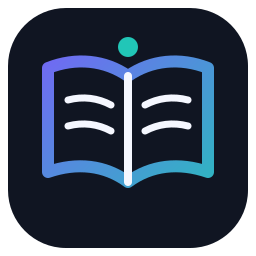
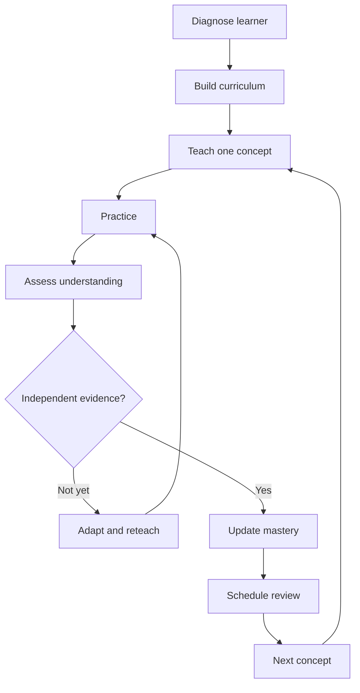

<div align="center">



# Learn Anything

### Learn anything. Actually understand it.

**An open-source adaptive learning engine for AI agents.**

Build a learning path. Teach one concept at a time. Test real understanding. Adapt to the learner. Keep progress portable.

[Get started](#-quick-start) · [How it works](#-how-it-works) · [Documentation](docs/README.md) · [Contribute](CONTRIBUTING.md) · [Support](#-support-the-project)

<br />

[](LICENSE)
[](https://www.python.org/)
[](skills/learn-anything/SKILL.md)
[](ROADMAP.md)

</div>

---

## The problem

Most AI tutoring is still a conversation-shaped content dump. It explains something, asks whether you understand, and often moves on whether you do or not.

**Learn Anything is designed around demonstrated understanding, not content consumption.**

It gives compatible AI agents a repeatable teaching method: diagnose what a learner knows, build a sensible route, teach in small steps, assess independent performance, and adapt when the learner gets stuck.

## What it does

- **Personalized learning paths** — organize topics around goals, current knowledge, and prerequisites.
- **Adaptive teaching** — explain, model, practice, assess, and change approach when needed.
- **Evidence-based mastery** — distinguish exposure, supported practice, independent proficiency, and durable mastery.
- **Visual learning** — use concept maps, process diagrams, annotated diagrams, roadmaps, simulations, and revision cards.
- **Portable progress** — represent curricula, lessons, assessments, and learner records with versioned JSON contracts.
- **Agent-friendly design** — keep the learning method separate from any one model provider or agent runtime.

## How it works



1. **Diagnose** the learner's goal, current level, and constraints.
2. **Plan** a prerequisite-aware curriculum with observable outcomes.
3. **Teach** one coherent concept using explanation and worked examples.
4. **Practice** with a task that requires the learner to think.
5. **Evaluate** correctness, independence, and transfer.
6. **Adapt** the next step using evidence, not guesswork.
7. **Reinforce** important ideas through delayed retrieval and review.

## Quick start

Learn Anything currently ships as an Agent Skills-compatible tutor skill. It is an early-stage framework, not a hosted course platform.

1. Open `skills/learn-anything/SKILL.md` and install it using your agent's skill mechanism.
2. Start a new learning session with this prompt:

> Teach me cybersecurity from absolute zero. Diagnose what I know, build a realistic learning roadmap, and start with the first concept. Teach one concept at a time and test my understanding before moving on.

3. The cybersecurity module is in `subjects/cybersecurity/`. The universal teaching workflow is in `core/`.
4. Read [installation instructions](docs/installation.md) for more detail.

**Pi example:** invoke the installed skill with `/skill:learn-anything` if your Pi setup uses that skill command. Other agents may use a different installation and invocation method.

## See the learning system

| Part | What it contains |
|---|---|
| Teaching engine | Diagnose → plan → teach → practice → assess → adapt → review |
| Subject modules | Prerequisites, outcomes, roadmaps, exercises, and safety boundaries |
| Visual components | Concept maps, process diagrams, annotated diagrams, roadmaps, simulations, revision cards |
| Data contracts | JSON Schemas for learner records, curricula, lessons, and assessments |
| Agent integration | Portable skill instructions and host-capability fallbacks |

Start with the [visual component catalogue](visual/README.md), [format standards](formats/README.md), and [architecture](docs/architecture.md).

## Content and presentation

These layers stay separate so the learning method can travel between agents:

- **Content** defines the concepts, explanations, examples, practice, and learning outcomes.
- **Data** records curricula, prerequisites, attempts, assessment evidence, and learner progress.
- **Presentation** decides how a host agent or future application displays lessons and visuals.

See the [format standards](formats/README.md) and [rendering contract](formats/rendering-contract.md).

## Design principles

- **Understanding over completion.** Finishing a lesson is not proof of learning.
- **Evidence over confidence.** Mastery needs repeated, independent demonstrations.
- **Portable over locked-in.** Learning content and progress should not depend on one vendor.
- **Learner-owned data.** Private progress belongs to the learner, not the repository.
- **Honest about capabilities.** A skill cannot magically provide persistence, browsing, rendering, or execution tools.
- **Safe by design.** Practical exercises must respect legal, ethical, and physical safety boundaries.

## Project status

**Early development · v0.1.0 foundation**

The repository includes the initial teaching workflow, Agent Skills entry point, cybersecurity starter module, portable schemas, visual component specifications, examples, and basic automated checks.

It does **not** yet provide a hosted platform, universal interactive renderer, automatic long-term storage, or proven learning-outcome claims. We are validating the learning method before building those layers.

See the [roadmap](ROADMAP.md) for planned work and current gaps.

## Development

Requirements: Python 3.10+ for repository checks. Using the tutor skill does not require Python.

```bash
python scripts/validate_project.py
python -m unittest discover -s tests -v
```

No third-party Python dependencies are required for these initial checks.

## Contributing

Contributions are welcome, especially subject modules, assessment cases, teaching improvements, accessibility fixes, and agent compatibility reports.

- Read [CONTRIBUTING.md](CONTRIBUTING.md).
- Check the [code of conduct](CODE_OF_CONDUCT.md).
- Report security concerns using [SECURITY.md](SECURITY.md).
- Open an issue for bugs or feature proposals.

## Support the project

Learn Anything is open source. If the project is useful to you and you'd like to help fund continued development, you can support the work here:

<div align="center">

### Support development

**[Buy the project a juice · $1](https://animiso.lemonsqueezy.com/checkout/buy/334c98ef-5133-400b-83a3-a4afc36e4f71)**

Small contributions help fund development time and better testing.

</div>

Support is optional. The project remains available under the Apache-2.0 license.

## License

Learn Anything is licensed under the [Apache License 2.0](LICENSE).

<div align="center">

**Learn anything. Actually understand it.**

<sub>Built in the open · Designed for learners · Made for AI agents</sub>

</div>
