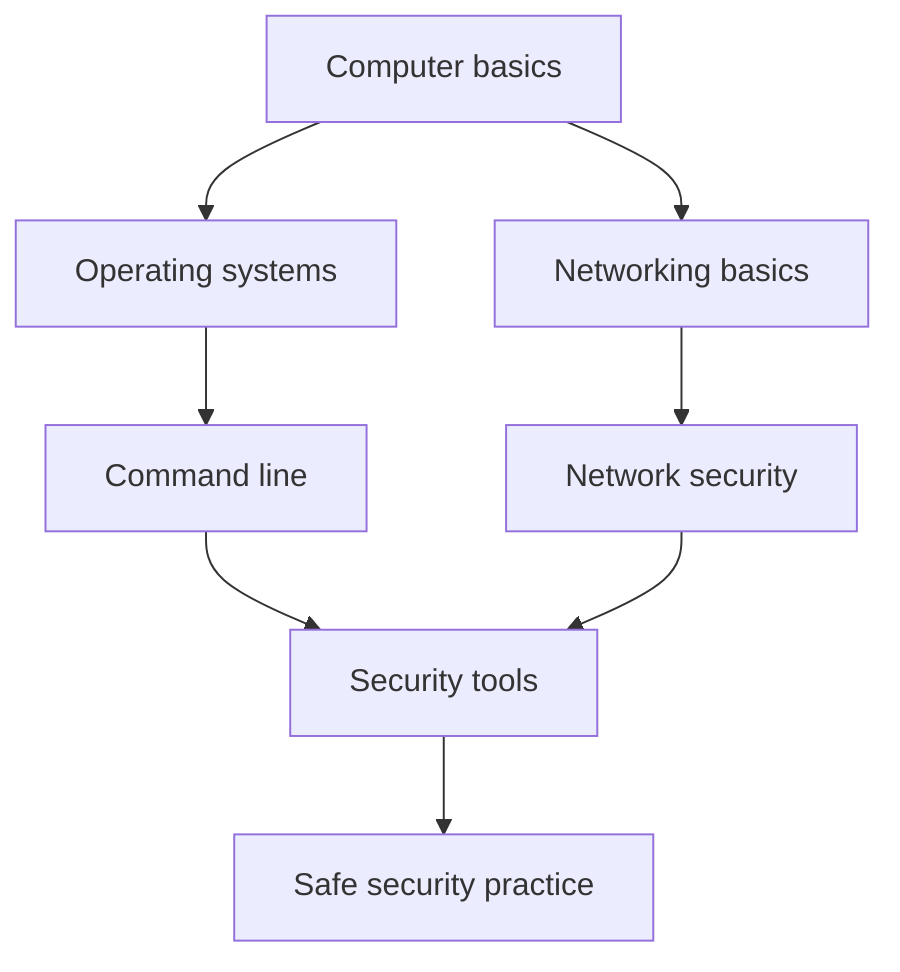

# Mermaid diagram standard

Use Mermaid for diagrams that materially improve understanding: prerequisite maps, concept relationships, processes, decision paths, and system sequences.

## Supported diagram types

Prefer these common, broadly supported types:

- `flowchart TD` for learning paths, prerequisites, and decision flows.
- `flowchart LR` for short pipelines or transformations.
- `sequenceDiagram` for interactions between components or actors.
- `stateDiagram-v2` for state transitions.
- `mindmap` only for lightweight concept maps; do not use it as a substitute for a prerequisite graph.

## Authoring rules

- Keep diagrams focused on one question.
- Use readable node labels and stable concept IDs where useful.
- Label conditional edges clearly.
- Keep diagrams small enough to read on a phone. Split large diagrams into stages.
- Do not encode the only copy of an important instruction, safety boundary, or assessment criterion in a diagram.
- Add a short prose explanation before or after the diagram describing what the learner should notice.
- Avoid experimental syntax and styling that may fail in older renderers.
- Validate Mermaid syntax when a renderer or linter is available. Never claim validation if it was not run.

## Example: prerequisite path

## Fallback

Follow [rendering-contract.md](rendering-contract.md). If Mermaid is unsupported or fails, provide a concise Markdown explanation and, only when useful, a small ASCII diagram. Never show broken Mermaid source as though it were a rendered diagram.
