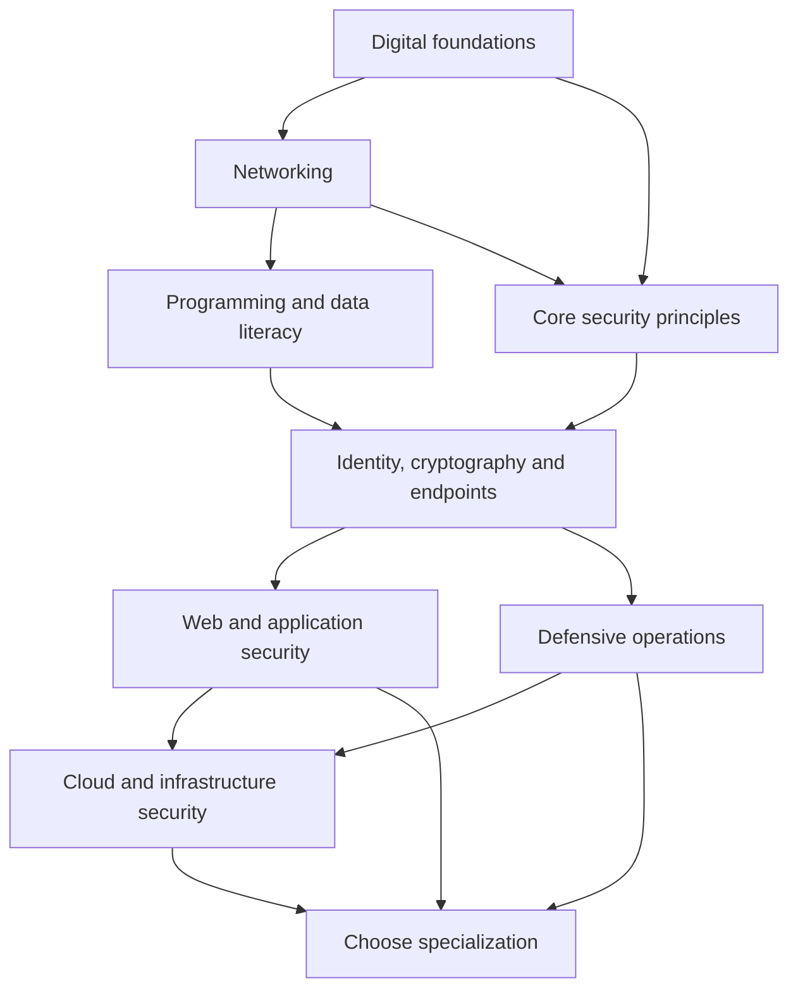

# Cybersecurity learning roadmap

This roadmap is a route map, not a fixed-duration bootcamp. The tutor should diagnose prior knowledge, adapt pacing, and preserve prerequisites.

## Core route

1. **Digital foundations:** computers, operating systems, files, permissions, browsers, updates, backups.
2. **Networking:** IP, DNS, ports, TCP/UDP, HTTP/HTTPS, TLS, routing, firewalls.
3. **Programming and data literacy:** Python basics, shell literacy, JSON/CSV, logs, Git, safe secrets.
4. **Core security:** CIA triad, identity, access control, threats, vulnerabilities, risk, controls, threat modeling.
5. **Identity, cryptography, and endpoints:** MFA, password managers, hashing, encryption, keys, patching, endpoint hardening.
6. **Web and application security:** sessions, access control, common weakness classes, secure coding, remediation.
7. **Defensive operations:** logging, monitoring, triage, incident response, vulnerability management, recovery.
8. **Cloud and infrastructure:** IAM, secrets, containers, configuration, supply chain, resilience.
9. **Specialization:** select a branch using interests and demonstrated foundations.

## Specialization routes

| Track | Core focus | Suggested capstone |
|---|---|---|
| Blue team / SOC | Logs, detection, triage, response | Investigate a simulated incident and write a report. |
| Application security | Secure design, code review, web/API defense | Review and remediate a toy application. |
| Cloud security | IAM, workload, network, storage, monitoring | Threat-model a fictional cloud deployment. |
| Authorized security testing | Scope, lab methods, validation, reporting | Assess an intentionally vulnerable lab and document remediation. |
| Digital forensics | Evidence, timelines, artifacts, reporting | Build a timeline from a supplied forensic dataset. |
| Malware analysis | Isolated analysis concepts and defensive indicators | Analyze a prepared benign training sample or report. |
| GRC and privacy | Risk, controls, policies, audits, privacy | Produce a risk register and control plan. |
| Security engineering | Secure architecture, automation, detection | Design a small defensive monitoring workflow. |

## Progress gates

- **Foundation gate:** learner can explain the basic system and network flow.
- **Security gate:** learner can distinguish risk concepts and justify proportionate controls.
- **Applied gate:** learner can interpret evidence, document uncertainty, and complete safe tasks independently.
- **Specialization gate:** learner can demonstrate branch prerequisites and explain legal scope, safety, and limitations.

Do not advance because the learner has watched a video or completed a checklist. Use independent explanation, application, diagnosis, transfer, and delayed review.

## Safe practice rule

All practical work must use owned systems, explicitly authorized targets, or intentionally vulnerable labs. If permission or scope is unclear, use synthetic data, a fictional scenario, or conceptual instruction instead. See [lab rules and projects](labs-and-projects.md).
