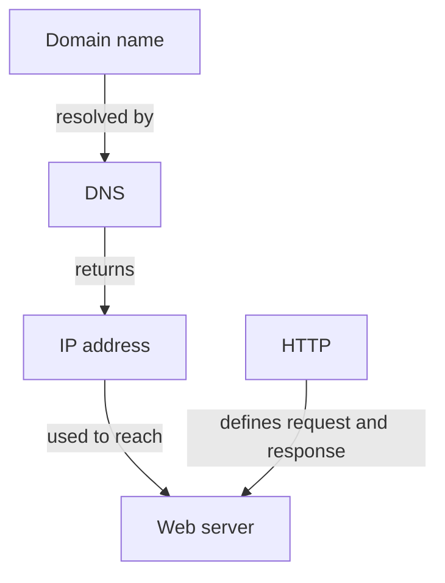

# Concept map

## Purpose

Show how concepts relate, overlap, or depend on one another. Use it when the relationship is itself the learning objective.

## Required data

- Stable concept IDs and concise labels.
- Labeled relationships with direction where direction matters.
- A short explanation of the most important relationship.
- A text fallback that describes the map in a readable sequence.

## Authoring rules

- Keep one central question per map.
- Prefer 5–12 nodes; split larger maps into submaps.
- Label edges with meaningful verbs such as "requires", "contains", "resolves", or "causes".
- Distinguish prerequisite edges from ordinary associations.
- Never imply causation from a simple association.
- Do not rely on colors or spatial position alone.

## Mermaid example

## Fallback

A domain name is looked up through DNS. DNS returns an IP address that the device can use to reach a web server. HTTP defines how the browser and server exchange web requests and responses.
