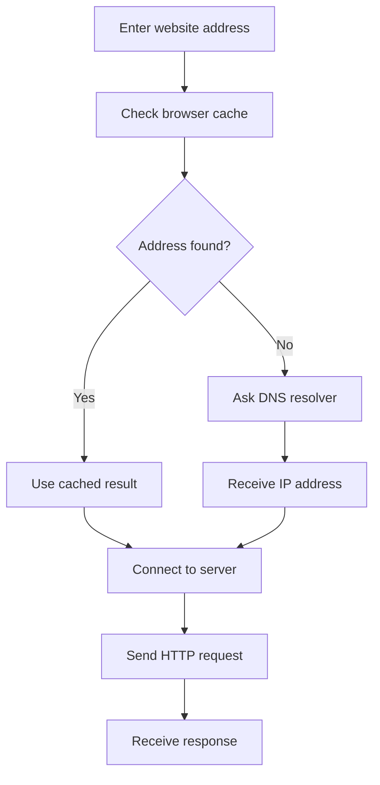

# Process diagram

## Purpose

Explain a sequence, mechanism, or decision process. Use a flow diagram when order and branching matter.

## Required data

- Ordered steps or states.
- Labeled transitions, including decision conditions.
- Start and end conditions where relevant.
- A prose description of the process.
- A text fallback that preserves the order and branch logic.

## Authoring rules

- One process per diagram.
- Use explicit decision labels such as "yes" and "no".
- Distinguish what happens from why it happens.
- Avoid crossing edges and long paragraphs inside nodes.
- Split complex processes into phases.
- Never use a flowchart as a substitute for a runnable simulation.

## Mermaid example

## Fallback

1. The browser checks whether it already knows the address.
2. If not, it asks a DNS resolver for an IP address.
3. The browser connects to the server.
4. It sends an HTTP request and receives a response.
