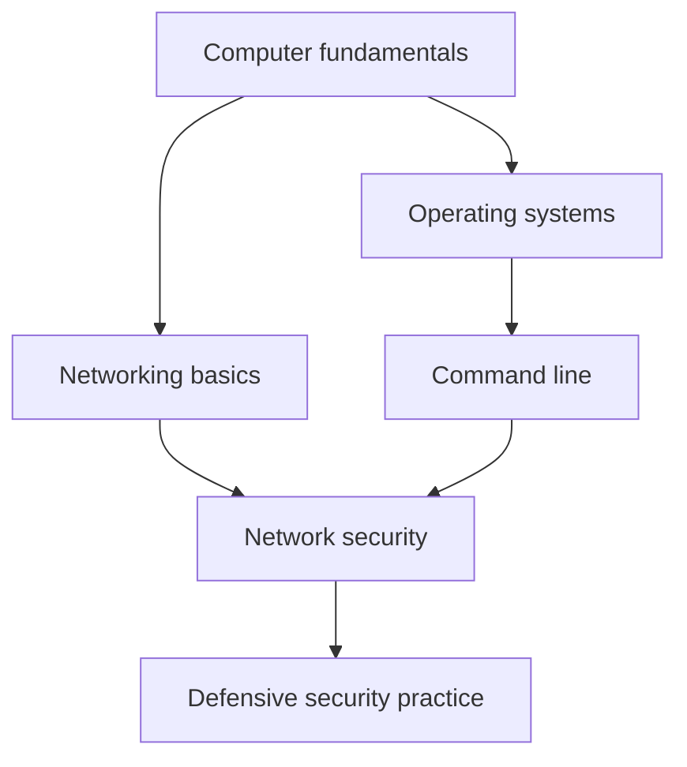

# Learning roadmap

## Purpose

Show the learner where they are, what they have completed, what comes next, and which prerequisites connect the stages.

## Required data

- Ordered stages with stable IDs.
- Outcomes for each stage.
- Prerequisite IDs.
- Status from the supported mastery states or an explicit not-started state.
- Checkpoint or evidence required to move forward.

## Authoring rules

- Base the route on the learner's goal and diagnostic evidence.
- Mark prerequisites explicitly; do not imply that completion of a stage proves mastery.
- Distinguish lesson exposure from demonstrated proficiency.
- Show optional branches separately from the essential path.
- Never invent progress. If learner data is unavailable, label the roadmap as a proposed plan.
- Provide a linear text outline as fallback.

## Example

## Fallback

1. Computer fundamentals
2. Operating systems and networking basics
3. Command line and network security
4. Defensive security practice

The route is a proposed sequence until learner-specific assessment evidence is available.
