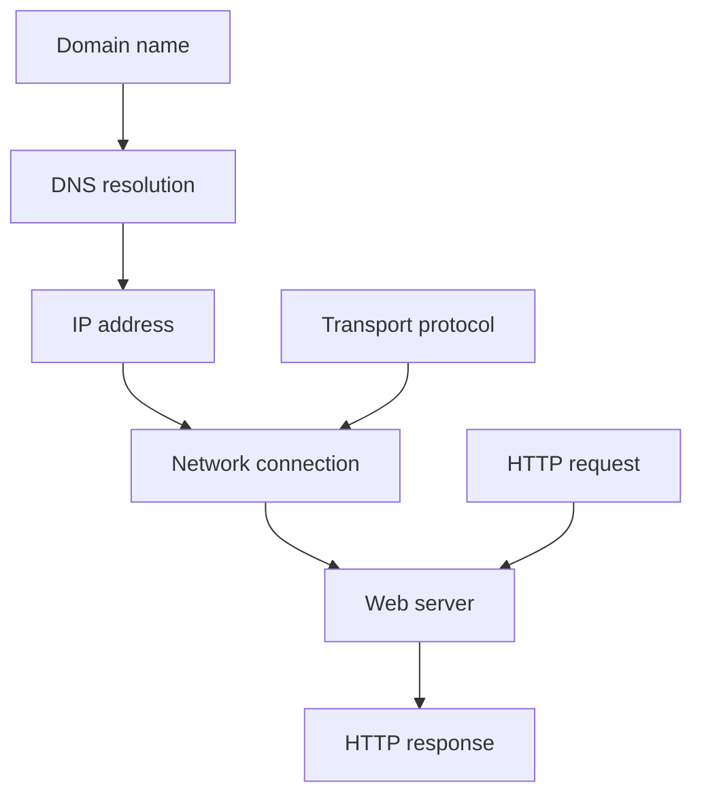

# Example: cybersecurity concept map

**Purpose:** show how foundational networking concepts relate to a basic web request.

**What to notice:** DNS resolution helps the client discover an IP address. The network connection provides a path to the server. HTTP describes the request and response exchanged with the web server. These are related steps, not interchangeable terms.

**Text fallback:** A browser resolves a domain name through DNS, uses the resulting IP address to reach a server, then exchanges an HTTP request and response.
