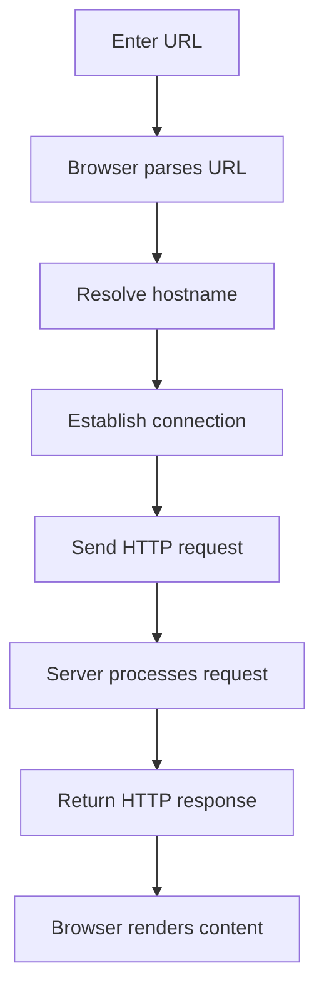

# Example: what happens when you visit a website

**Learning objective:** describe the main stages between entering a URL and receiving a web response.

**What to notice:** name resolution, connection setup, HTTP exchange, and rendering are different stages. Real browsers may reuse cached data and existing connections, so this is a teaching model rather than a complete packet-level trace.

**Text fallback:** The browser parses the URL, resolves the hostname, establishes or reuses a connection, sends a request, receives a response, and renders the returned content.
